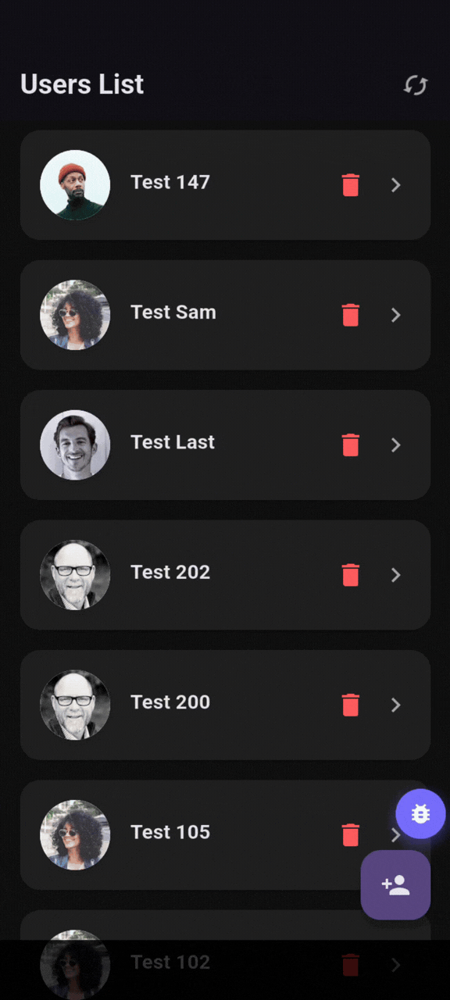
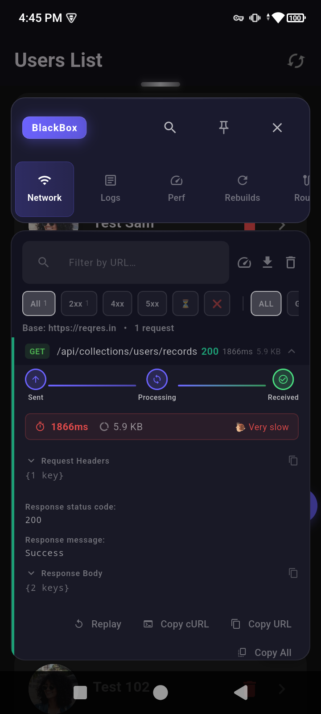
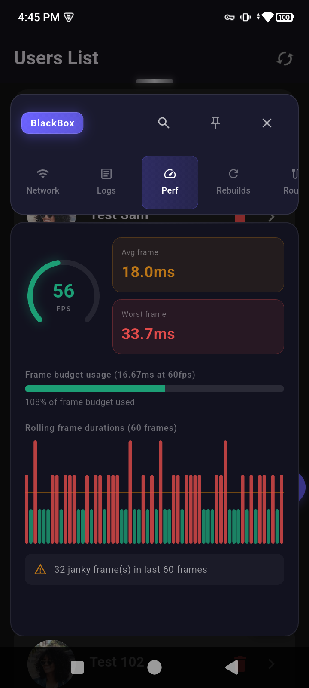

# Flutter BlackBox 🐞

[](https://pub.dev/packages/flutter_blackbox)
[](https://opensource.org/licenses/MIT)
[](https://github.com/jaiminraval2704/flutter_blackbox/actions/workflows/ci.yml)

An all-in-one **in-app debug & QA overlay** for Flutter — network inspector, API mocking, live logs, FPS monitor, rebuild tracker, storage inspector, crash reports, and QA tools. **Zero runtime cost** in release builds. **Zero optional dependencies** — the CLI generates only the adapters you need.

<p align="center">
  
</p>

<p align="center">
  
  
  
</p>

---

**BlackBox** is the ultimate native debug overlay and remote dashboard for Flutter apps. Inspect network requests, debug logs, widget rebuilds, feature flags, crashes, and device telemetry—either right on your device screen via the **Cyberpunk-styled overlay**, or remotely on your desktop browser using the **Web Companion**.

## ✨ Features

- **🌐 Network Inspector** — Intercept HTTP/Dio/Socket requests. View headers, timing metrics, response sizes, and a beautifully syntax-highlighted **Interactive JSON Tree**.
- **💻 Remote Web Companion** — Beam real-time logs and network calls to the [BlackBox Web Dashboard](https://flutter-blackbox-companion.web.app) via Firebase or local Wi-Fi.
- **🚀 Cyberpunk Native Overlay** — A buttery-smooth, frosted-glass (`BackdropFilter`) overlay with velocity-snapped resizing that floats over your app without disrupting the UI.
- **⚡ Performance & Rebuilds** — Track live FPS, spot frame drops, and monitor aggressive widget rebuilds.
- **🗄️ Storage Inspector** — View and edit `SharedPreferences` or other local databases securely.
- **🔒 Privacy First** — Auto-redacts sensitive keys (passwords, tokens) before they ever hit the memory store.
- **🛠️ Zero Dependencies** — The core `flutter_blackbox` package has zero optional dependencies. It generates adapters specifically for what you use.

| Panel | Description |
|-------|-------------|
| **🌐 Network** | Real-time HTTP/Dio interception. Headers, payloads, status codes, timing bars, cURL export, HAR export. Swipe to dismiss individual entries. |
| **🎛 Mocking** | Intercept and replace API calls with local JSON responses. Simulate slow networks with throttle slider. |
| **📋 Logs** | Auto-captures `debugPrint`/`print`. Manual logging with levels and tags. Swipe to dismiss, color-coded accent borders. |
| **⚡ Performance** | Live FPS graph, jank detection, frame budget visualization. |
| **🔄 Rebuilds** | Track widget rebuild counts — auto-detect ALL rebuilds or wrap specific widgets. Pull-to-refresh resets counts. |
| **💾 Storage** | Inspect, search, edit, and delete key-value pairs. Sensitive data auto-redacted. Supports SharedPreferences, GetStorage, Hive, etc. |
| **🔌 Socket IO** | Auto-capture all incoming Socket.IO events. Zero code changes. |
| **📱 Device** | Platform, screen metrics, pixel ratio, text scale — in glassmorphic cards. |
| **🐛 Crashes** | Auto-catches framework errors, async exceptions, and unhandled crashes. |
| **🗺️ Journey** | Route changes and interactions logged to reconstruct steps before a crash. |
| **📝 QA Reports** | One-tap Markdown reports with screenshot, device info, journey, network logs, and stack traces. |
| **📊 Mini HUD** | Drag the floating button to the bottom edge for a persistent live HUD (FPS, HTTP status, crash count). |

---

## 📦 Installation

```yaml
dependencies:
  flutter_blackbox: ^0.7.0
```

---

## 🛡️ Zero Impact in Production

BlackBox is designed to be completely invisible and zero-cost in release builds.

- **Auto-disabled via `kDebugMode`**: `BlackBox.setup()` exits immediately in release mode. No adapters are attached, no listeners are registered.
- **Zero Widget Tree Overhead**: The `BlackBoxOverlay` widget returns your raw `child` in release mode. It does not insert any `Stack`, `Overlay`, or `Builder` into the widget tree.
- **Tree-Shaking Guarantees**: Heavy features like Firebase streaming are wrapped in `kDebugMode` guards, allowing the Dart compiler to tree-shake them entirely from your release binary.
- **Memory Caps**: All internal stores (Logs, Network, Crashes) have strict capacity limits (e.g., max 500 network calls) and automatically truncate payloads exceeding 100KB to prevent memory leaks during intense debug sessions.

---

## 🛠 Quick Start

Core features work with **zero adapters** — just wrap your app:

```dart
import 'package:flutter/foundation.dart';
import 'package:flutter_blackbox/flutter_blackbox.dart';

void main() {
  BlackBox.setup(
    trigger: const BlackBoxTrigger.floatingButton(),
    enabled: kDebugMode,
  );
  runApp(const BlackBoxOverlay(child: MyApp()));
}
```

This gives you: logs, crashes, FPS, rebuilds, device info, and QA reports out of the box.

---

## 🤖 Auto-Setup CLI

BlackBox ships with a CLI that reads your `pubspec.yaml` and generates adapter code for your specific dependencies:

```bash
# Generate adapters (Dio, http, Socket.IO, SharedPreferences — only what you use)
dart run flutter_blackbox:init --generate
```

This creates `lib/blackbox_adapters.dart`. Then use it:

```dart
import 'package:flutter_blackbox/flutter_blackbox.dart';
import 'blackbox_adapters.dart'; // ← generated

final dio = Dio();

void main() {
  BlackBox.setup(
    httpAdapters: [DioBlackBoxAdapter(dio)],
    storageAdapters: [SharedPrefsStorageAdapter()],
    logAdapter: PrintLogAdapter(),
    trigger: const BlackBoxTrigger.floatingButton(),
    enabled: kDebugMode,
  );
  runApp(const BlackBoxOverlay(child: MyApp()));
}
```

> 💡 Re-run `--generate` any time you add a new library.

---

## 🌐 Network Adapters

```dart
// Dio
BlackBox.setup(httpAdapters: [DioBlackBoxAdapter(dio)]);

// http package
final adapter = HttpBlackBoxAdapter();
BlackBox.setup(httpAdapters: [adapter]);
final response = await adapter.client.get(Uri.parse('https://api.example.com'));
```

BlackBox **observes** your calls silently — zero changes to your API code.

---

## 📡 External Observers (Crashlytics / Sentry)

Forward crashes and network errors to external monitoring tools:

```dart
class CrashlyticsObserver extends BlackBoxObserver {
  @override
  void onCrash(CrashEntry crash) {
    FirebaseCrashlytics.instance.recordError(crash.message, crash.stackTrace);
  }
}

BlackBox.setup(observers: [CrashlyticsObserver()]);
```

---

## 💾 Custom Storage Adapters

Implement `BlackBoxStorageAdapter` for any key-value store:

```dart
class GetStorageAdapter extends BlackBoxStorageAdapter {
  final GetStorage _box;
  GetStorageAdapter(this._box);

  @override String get name => 'GetStorage';
  @override Future<Map<String, dynamic>> readAll() async => _box.getValues();
  @override Future<void> write(String key, dynamic value) async => _box.write(key, value);
  @override Future<void> delete(String key) async => _box.remove(key);
  @override Future<void> clear() async => _box.erase();
}
```

> Sensitive keys (`password`, `token`, `secret`, `jwt`, etc.) are **auto-redacted** by default.

---

## 🔄 Widget Rebuild Tracker

```dart
// Automatic — toggle "AUTO ON" in the Rebuilds panel, or:
BlackBox.startRebuildTracking();

// Manual — wrap specific widgets:
RebuildTracker(label: 'ProductCard', child: ProductCard())
```

---

## 🎛 API Mocking

```dart
BlackBox.mock(
  pattern: '/api/v1/user/profile',
  method: 'GET',
  response: MockResponse(statusCode: 200, body: {'name': 'Alice'}),
);
```

---

## 🎮 Panel Triggers

```dart
BlackBox.setup(
  trigger: BlackBoxTrigger.floatingButton(),  // Floating button (default)
  // trigger: BlackBoxTrigger.shake(),         // Shake device
  // trigger: BlackBoxTrigger.hotkey(LogicalKeyboardKey.f12), // Desktop F12
);
```

---

## ✨ What's New in 0.7.0

- **BlackBox Companion Web App** — Connect your app to our new [Web Companion Dashboard](https://flutter-blackbox-companion.web.app) to view logs, network requests, and device info on your desktop browser in real-time!
- **"Cyberpunk" UI Overhaul** — The entire BlackBox overlay upgraded to a premium aesthetic featuring glowing neon accents, deep dark backgrounds, and frosted-glass panels (`BackdropFilter`).
- **Interactive JSON Tree** — The Network Panel now features a fully interactive, collapsible JSON tree. Syntax-highlighted keys (neon blue), strings (neon green), booleans (neon pink), and nulls (soft red).
- **Scanner Quick-Action** — Added a new scanner icon right next to the pin icon in the main overlay header to jump instantly to the "Link" companion setup tab.
- **Velocity Snapping** — The draggable overlay top-handle now respects swipe velocity, allowing you to flick the panel up to instantly snap it to maximum height or flick down to snap it to its resting height.

See [CHANGELOG.md](CHANGELOG.md) for full details.

---

## 📄 License

MIT.
