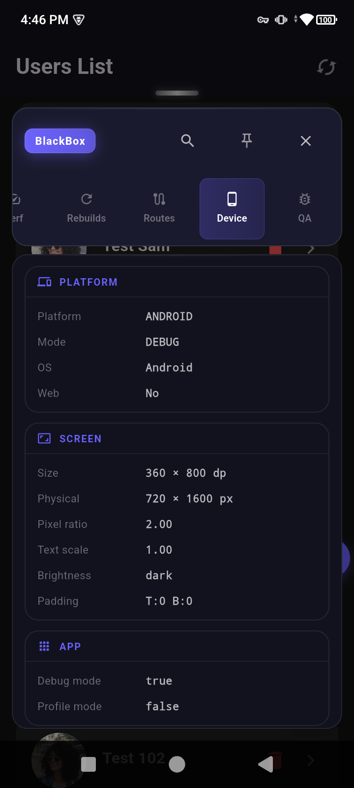

# Flutter BlackBox 🐞

[](https://pub.dev/packages/flutter_blackbox)
[](https://pub.dev/packages/flutter_blackbox/score)
[](https://opensource.org/licenses/MIT)
[](https://github.com/jaiminraval2704/flutter_blackbox/actions/workflows/ci.yml)

An all-in-one **in-app debug & QA overlay** for Flutter — network inspection, API mocking, live logs, frame performance, rebuild tracking, storage inspection, crash reports, and QA tools. Capture hooks are disabled in release builds. Adapter-specific packages are generated only for the integrations your app uses.

<p align="center">
  
</p>

<p align="center">
  
  
  
</p>

---

**BlackBox** is a native debug overlay and remote dashboard for Flutter apps. Inspect network requests, debug logs, widget rebuilds, crashes, and device details on your device, or stream supported diagnostics to the **Web Companion**.

## ✨ Features

- **🌐 Network Inspector** — Capture HTTP and Dio requests, plus Socket.IO events through their adapters. Inspect headers, timing metrics, response sizes, and JSON bodies.
- **💻 Remote Web Companion** — Stream supported diagnostics to the [BlackBox Web Dashboard](https://flutter-blackbox-companion.web.app) through Firebase.
- **🚀 Native Overlay** — A frosted-glass (`BackdropFilter`) overlay with resizable panels that sits above your app.
- **⚡ Performance & Rebuilds** — Track FPS, UI and raster frame times, jank, and widget rebuilds.
- **⏯️ Capture Sessions** — Pause and resume collection or clear captured data from the existing header, without adding a tab.
- **🧠 Memory Controls** — Detach and bound captured payloads, and inspect retained-entry estimates plus dropped and truncated counts.
- **🗄️ Storage Inspector** — View and edit `SharedPreferences` or other local databases securely.
- **🔒 Privacy First** — Auto-redacts sensitive keys (passwords, tokens) before they ever hit the memory store.
- **🛠️ Adapter Generation** — Generate only the adapters needed for your app's HTTP, socket, logging, and storage integrations.

| Panel | Description |
|-------|-------------|
| **🌐 Network** | Real-time HTTP/Dio interception. Headers, payloads, status codes, timing bars, cURL export, HAR export. Swipe to dismiss individual entries. |
| **🎛 Mocking** | Intercept and replace API calls with local JSON responses. Simulate slow networks with throttle slider. |
| **📋 Logs** | Auto-captures `debugPrint`/`print`. Manual logging with levels and tags. Swipe to dismiss, color-coded accent borders. |
| **⚡ Performance** | Live FPS graph, UI/raster/total frame timings, jank and frame-budget metrics, capture footprint, and process RSS. |
| **🔄 Rebuilds** | Track widget rebuild counts — auto-detect ALL rebuilds or wrap specific widgets. Pull-to-refresh resets counts. |
| **💾 Storage** | Inspect, search, edit, and delete key-value pairs. Sensitive data auto-redacted. Supports SharedPreferences, GetStorage, Hive, etc. |
| **🔌 Socket IO** | Auto-capture all incoming Socket.IO events. Zero code changes. |
| **📱 Device** | Platform, screen metrics, pixel ratio, text scale — in glassmorphic cards. |
| **🐛 Crashes** | Auto-catches framework errors, async exceptions, and unhandled crashes. |
| **🗺️ Journey** | Route changes and interactions logged to reconstruct steps before a crash. |
| **📝 QA Reports** | One-tap Markdown reports with screenshot, device info, journey, network logs, and stack traces. |
| **📊 Mini HUD** | Drag the floating button to the bottom edge for a persistent live HUD (FPS, HTTP status, crash count). |

---

## 📦 Installation

```yaml
dependencies:
  flutter_blackbox: ^0.8.0
```

---

## 🛡️ Zero Impact in Production

BlackBox disables diagnostic capture in release builds by default.

- **Auto-disabled via `kDebugMode`**: Unless explicitly enabled, `BlackBox.setup()` does not attach adapters or install capture hooks in release mode.
- **Zero Widget Tree Overhead**: The `BlackBoxOverlay` widget returns your raw `child` in release mode. It does not insert any `Stack`, `Overlay`, or `Builder` into the widget tree.
- **Bounded retention**: Stores limit the number of retained entries, and large payloads are detached and capped before they are retained. Network bodies are limited to 100 KB; other payload types have their own limits.
- **Session pause**: `BlackBox.pauseCapture()` pauses new diagnostic events while keeping attached adapters available so collection resumes immediately.

---

## 🛠 Quick Start

Core features work with **zero adapters** — just wrap your app:

```dart
import 'package:flutter/foundation.dart';
import 'package:flutter_blackbox/flutter_blackbox.dart';

void main() {
  BlackBox.setup(
    trigger: const BlackBoxTrigger.floatingButton(),
    enabled: kDebugMode,
  );
  runApp(const BlackBoxOverlay(child: MyApp()));
}
```

This gives you logs, crashes, FPS, rebuild tracking, device details, and QA reports. Use `BlackBox.pauseCapture()`, `BlackBox.resumeCapture()`, and `BlackBox.clearCapturedData()` to control the session. These controls are also available in the existing overlay header.

---

## 🤖 Auto-Setup CLI

BlackBox ships with a CLI that reads your `pubspec.yaml` and generates adapter code for your specific dependencies:

```bash
# Generate adapters (Dio, http, Socket.IO, SharedPreferences — only what you use)
dart run flutter_blackbox:init --generate
```

This creates `lib/blackbox_adapters.dart`. Then use it:

```dart
import 'package:flutter_blackbox/flutter_blackbox.dart';
import 'blackbox_adapters.dart'; // ← generated

final dio = Dio();

void main() {
  BlackBox.setup(
    httpAdapters: [DioBlackBoxAdapter(dio)],
    storageAdapters: [SharedPrefsStorageAdapter()],
    logAdapter: PrintLogAdapter(),
    trigger: const BlackBoxTrigger.floatingButton(),
    enabled: kDebugMode,
  );
  runApp(const BlackBoxOverlay(child: MyApp()));
}
```

> 💡 Re-run `--generate` any time you add a new library.

---

## 🌐 Network Adapters

```dart
// Dio
BlackBox.setup(httpAdapters: [DioBlackBoxAdapter(dio)]);

// http package
final adapter = HttpBlackBoxAdapter();
BlackBox.setup(httpAdapters: [adapter]);
final response = await adapter.client.get(Uri.parse('https://api.example.com'));
```

BlackBox **observes** your calls silently — zero changes to your API code.

---

## 📡 External Observers (Crashlytics / Sentry)

Forward crashes and network errors to external monitoring tools:

```dart
class CrashlyticsObserver extends BlackBoxObserver {
  @override
  void onCrash(CrashEntry crash) {
    FirebaseCrashlytics.instance.recordError(crash.message, crash.stackTrace);
  }
}

BlackBox.setup(observers: [CrashlyticsObserver()]);
```

---

## 💾 Custom Storage Adapters

Implement `BlackBoxStorageAdapter` for any key-value store:

```dart
class GetStorageAdapter extends BlackBoxStorageAdapter {
  final GetStorage _box;
  GetStorageAdapter(this._box);

  @override String get name => 'GetStorage';
  @override Future<Map<String, dynamic>> readAll() async => _box.getValues();
  @override Future<void> write(String key, dynamic value) async => _box.write(key, value);
  @override Future<void> delete(String key) async => _box.remove(key);
  @override Future<void> clear() async => _box.erase();
}
```

> Sensitive keys (`password`, `token`, `secret`, `jwt`, etc.) are **auto-redacted** by default.

---

## 🔄 Widget Rebuild Tracker

```dart
// Automatic — toggle "AUTO ON" in the Rebuilds panel, or:
BlackBox.startRebuildTracking();

// Manual — wrap specific widgets:
RebuildTracker(label: 'ProductCard', child: ProductCard())
```

---

## 🎛 API Mocking

```dart
BlackBox.mock(
  pattern: '/api/v1/user/profile',
  method: 'GET',
  response: MockResponse(statusCode: 200, body: {'name': 'Alice'}),
);
```

---

## 🎮 Panel Triggers

```dart
BlackBox.setup(
  trigger: BlackBoxTrigger.floatingButton(),  // Floating button (default)
  // trigger: BlackBoxTrigger.shake(),         // Shake device
  // trigger: BlackBoxTrigger.hotkey(LogicalKeyboardKey.f12), // Desktop F12
);
```

---

## ⏯️ Capture Sessions

Pause or resume new diagnostics without detaching adapters, and clear the current session without adding another panel tab:

```dart
BlackBox.pauseCapture();
BlackBox.resumeCapture();
BlackBox.clearCapturedData();

if (BlackBox.isCapturing) {
  // BlackBox is accepting new events.
}
```

Pausing stops new capture while preserving existing data. A network response can still finish a request that was captured before pause. Clearing asks for confirmation in the overlay and keeps the current paused or recording state. The Performance panel shows approximate retained memory, dropped or truncated items, and process RSS; RSS is process-wide and is not BlackBox-only memory.

For unnamed imperative routes, provide a stable diagnostic name without executing the route builder:

```dart
BlackBox.setup(
  routeNameResolver: (route) => route.settings.arguments == '/checkout'
      ? 'CheckoutPage'
      : null,
);
```

---

## ✨ What's New in 0.8.0

- Pause, resume, and clear capture from the existing header; the tab layout stays the same.
- Captured payloads are detached and bounded before storage or companion transmission.
- FPS monitoring reports UI, raster, total frame times, and jank; capture metrics include retained-size estimates and dropped/truncated counts.
- Repeated setup and disposal preserve store subscriptions and release adapters, timers, Firebase work, and overlay resources.
- Route builders are no longer invoked to guess route names. Use `routeNameResolver` to label unnamed imperative routes.

See [CHANGELOG.md](CHANGELOG.md) for full details.

---

## 📄 License

MIT.
